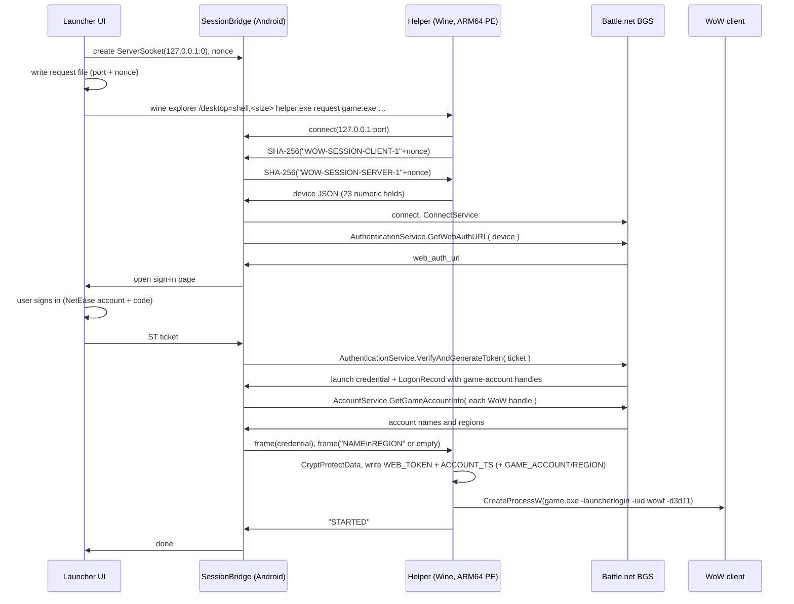

# Battle.net browser sign-in on ARM64 Wine

How the app signs a CN (NetEase) Battle.net account into the ARM64-native WoW client, and every
Wine/ARM64 trap that had to be cleared to make it work.

## Why this path exists

The client's `-launcherlogin` mode signs in with a **launch credential** produced by Battle.net,
not with a username and password. Battle.net hands that credential out through its own service
protocol (BGS) during a browser sign-in. On CN the account authority is NetEase, so the browser
flow is the only supported route — the old password/`login.txt` path and the cached-ST-token path
have both been removed.

The credential never touches the game's files: the helper writes it DPAPI-protected into
`HKCU\Software\Blizzard Entertainment\Battle.net\Launch Options\WoW` and the client consumes it on
that launch.

## Components

| Path | Role |
| :--- | :--- |
| `ui/screen/wow/auth/BattleNetBrowserLogin.kt` | Orchestrator: opens the bridge, launches the helper, drives the failure dialog. |
| `ui/screen/wow/auth/SessionBridge.kt` | `127.0.0.1` `ServerSocket`, nonce-authenticated handshake, 4-byte big-endian length framing. |
| `ui/screen/wow/auth/BgsClient.kt` / `BgsProtocol.kt` | Battle.net service protocol over TLS to port 1119; produces the sign-in URL, exchanges the ST ticket for a game credential, and names the login's WoW accounts. |
| `ui/screen/wow/auth/BrowserAuthUrl.kt` | Allowlist for the sign-in page (hosts, redirects, `ST=` parsing). |
| `ui/screen/wow/auth/BattleNetWebDialog.kt` | WebView host for the sign-in page. |
| `tools/wow-session-bridge/` | The ARM64 helper (`bridge.c`, `protocol.c`, `device_id.c`) that runs inside the prefix. |

## Flow



## Helper stages

The helper reports its stage as `stage N failed` in `C:\wow-session\bridge.log`; the failure dialog
shows that log so a locked-down launch is never silent.

| Stage | Work |
| :--- | :--- |
| 2 | `argc >= 3`, read the one-shot request file (`FILE_FLAG_DELETE_ON_CLOSE`) |
| 3 | named mutex `Local\WoWForever.SessionBridge` (non-blocking) |
| 4 | `WSAStartup`, socket, 15 min send/recv timeouts |
| 5 | `connect(127.0.0.1:port)` |
| 6 | nonce proof exchange |
| 7 | device JSON frame |
| 8 | receive the launch credential |
| 9 | sanity check the game path, no `login.txt`, build command line |
| 10 | `CryptProtectData` |
| 11 | write `WEB_TOKEN` / `ACCOUNT_TS`, write `GAME_ACCOUNT`/`REGION` for the sole account (or drop them), flush |
| 12 | `CreateProcessW`, send `STARTED`, focus the game window, wait for it |

## Pitfalls (all of these were real)

### Toolchain and loading

1. **The ARM64EC prefix has no `api-ms-win-*.dll`.** It ships `ucrtbase.dll` and `msvcrt.dll`, but
   zero API-set shims — the game only imports `USER32.dll`, so upstream dropped them. A helper built
   with the UCRT variant imports nine `api-ms-win-crt-*.dll` and dies with `STATUS_DLL_NOT_FOUND
   (0xC0000135)` *before* `wmain`, leaving no log at all. **Build with the llvm-mingw `msvcrt`
   variant**; its imports are `msvcrt.dll` plus the six system DLLs.
2. Do not build the helper x86-64: that needs FEX and hits the same UCRT gap.
3. The helper must be a **`-municode` `wmain`** program, and its file name must contain `ARM64` so
   `XServerScreen` dispatches it natively instead of through `winhandler.exe`.

### Launching the helper

4. **Wine's `CreateProcessW(NULL, cmdline)` does not strip quotes from the first token.** The
   explorer's `manage_desktop` hands the rest of its command line straight to `CreateProcessW`, whose
   `find_exe_file` then searches for `"C:\wow-session\wow-session-bridge.exe"` — quotes included — and
   fails. Keep the helper/request/game paths **unquoted**; they contain no spaces.
5. The helper needs the explorer's virtual desktop: launch it as
   `wine explorer /desktop=shell,<width>x<height> <helper> …`, not with a bare `wine`.
6. `-mwindows` makes the helper a GUI-subsystem program, so **its stdout and stderr are discarded**.
   Diagnostics must go to a file (and are surfaced in the dialog) or to `OutputDebugStringA` with
   `WINEDEBUG=+debugstr`.

### Wine / msvcrt behaviour

7. **Wine's msvcrt `vsnprintf` returns 0 bytes on ARM64** for most format strings. A `printf`-based
   JSON writer therefore emitted only the last `puts(" }")` — a 3-byte device frame — and the Android
   side threw `JSONException`. Assemble strings with explicit appends; `snprintf` (non-`v`) is fine.
8. `WINEDEBUG=+seh` massively slows exception dispatch and trips the anti-cheat's
   `udf` + `cntvct_el0` timing check. Use `err+all` (plus a single extra channel while diagnosing).
   `+winsock`, `+debugstr` and `+process` are safe; `+process` is very verbose.
9. `PROTON_NO_NTSYNC=1` is required for hostname/socket initialisation in this container.
10. Proton **11.0-90624** is the version whose display driver works; 11.0-2 broke it
    (`nodrv_CreateWindow`).

### Protocol details

11. Bridge frames are a 4-byte **big-endian** length followed by the payload; `bridge_encode_length`
    must match `DataInputStream.readInt`.
12. Device JSON must contain exactly the 23 keys (`RGKY … MAC`) with numeric values; the Android side
    validates both the key set and the 0…2³²−1 range.
13. `GetLastError()` is meaningless for Winsock failures — `recv` reports through `WSAGetLastError()`.
    A stage-8 failure showing `GetLastError=6` simply means the peer had already closed the socket.

### Battle.net specifics

14. The CN service host is **`cn.actual.battlenet.com.cn`**; `cn.actual.battle.net` does not resolve.
15. The CN redirect appends extra parameters after `ST=` (`&1owTrackingId=…`), so parse the ticket by
    name and reject an encoded `%53T`.
16. Allow the NetEase domains (`.battlenet.com.cn`, `163.com`, `126.com`, `yeah.net`, `netease.com`,
    `neteasegames.com`) in the sign-in allowlist, or the page is rejected as "unsupported sign-in
    address".
17. Delete `_forever_/login.txt` before starting browser login: an empty file selects the password
    path instead of the launcher session.
18. `Local\WoWForever.SessionBridge` is per prefix; a stale helper holds it and stage 3 fails.
19. A Battle.net login may hold several WoW accounts. The game starts as the account named by
    `GAME_ACCOUNT` with its `REGION` (`US`/`EU`/`KR`/`TW`/`CN`); without them it asks in game, and a
    pair left from an earlier login must be dropped. The bridge carries a sole account's name and
    region after the credential frame (an empty frame when there is no sole account), and the helper
    writes both values next to the ticket. Names come from `AccountService.GetGameAccountInfo`
    (hash `0x22dc2464`, method 201) for the handles in the LogonRecord; a lookup failure leaves the
    values unset rather than guessing a licence.

## Troubleshooting

| Symptom | Cause | Fix |
| :--- | :--- | :--- |
| Dialog shows no helper log at all | Helper never ran (launch failed) or crashed before `wmain` | Check the launch command for quotes; verify the helper is the msvcrt build |
| `stage 2 failed` | Request file unreadable/deleted | Ensure the prefix is writable and no second launcher consumed it |
| `stage 3 failed` | Mutex held by a stale helper | Kill leftover `wow-session-bridge.exe` in the prefix |
| `stage 5 failed` | Loopback refused | Check that the SessionBridge is listening and the port in the request file matches |
| `stage 8 failed` | Android side aborted before sending the credential | Read the dialog message: it names the failing step |
| `Browser sign-in could not start the game (…)` | Unexpected exception on the Android side | The parenthesised class identifies the layer; `JSONException` means a malformed device frame |
| `unsupported sign-in address` | Redirect outside the allowlist | Add the host to `BrowserAuthUrl` |

## Diagnostics

The client reports a refused session only in its own log and on screen — never to the app — so every
launch through `BattleNetBrowserLogin.start` first copies what the previous run left behind into the
shared cache, readable without root or adb:

```
/sdcard/Download/WoWForever/logs/
  browser-login.log   sign-in stages: region, build, command, challenge host, ticket/token sizes,
                      helper STARTED, failure text. No cookies, URLs or credentials.
  wow-client/         the last run's `_forever_/Logs/*.log` and `WTF/Config.wtf`, `.build.info`,
                      and the helper's `bridge.log` (overwritten on every launch)
```

`WINEDEBUG=-all,+debugstr` additionally forwards the client's `OutputDebugString` diagnostics to
`last-run.log` in the same directory. `+debugstr` is cheap and, unlike `+seh`, does not trip the
anti-cheat timing check.

`browser-login.log`'s `launch options:` line lists the `WEB_TOKEN` size, `ACCOUNT_TS`, `GAME_ACCOUNT`
and `REGION` values of the launch-options key as the previous launch left them; the protected token
itself is never read.

## Security notes

- The bridge is loopback-only, single-use, nonce-authenticated before any data flows, and the request
  file carries only a port and a nonce.
- The credential exists in plaintext only in memory, is DPAPI-protected for the registry, and is
  cleared from the registry when the helper owns it and fails.
- The failure dialog shows a helper stage log and an exception class, never page content, redirect
  URLs or credentials.
