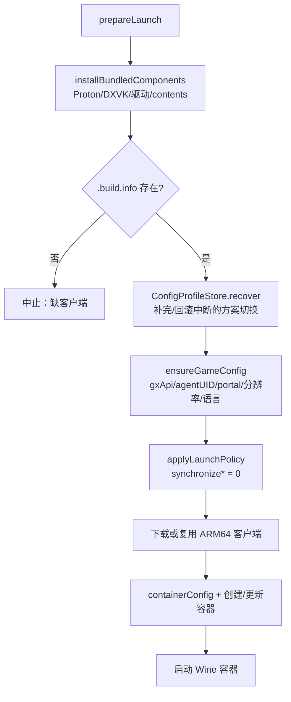
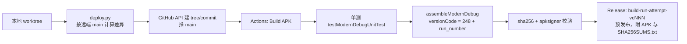

# 项目文档（开发向）

面向改代码的人：模块职责、启动链路、插件配置方案的实现、构建与部署工作流。
用户向说明见 [README.md](README.md)，Battle.net 登录细节见 [BATTLE_NET_BROWSER_LOGIN.md](BATTLE_NET_BROWSER_LOGIN.md)。

## 1. 这是什么

Android 启动器：在 Snapdragon 设备上直接运行暴雪官方的 **Windows ARM64** WoW Forever 客户端。
宿主进程负责下载/校验客户端、解包 Proton 与图形组件、拼装 Winlator 容器、登录 Battle.net 并拉起游戏；
游戏本体通过 Wine + DXVK + Turnip 原生跑在手机 CPU/GPU 上，不做 x86 指令翻译。

## 2. 代码结构

```text
app/src/main/java/app/gamenative/
├── MainActivity.kt, PluviaApp.kt        入口 Activity / Hilt Application
├── ui/screen/wow/                       启动器核心（本项目主要改动都在这里）
│   ├── WoWForeverScreen.kt              主界面、prepareLaunch、ensureGameConfig、容器配置
│   ├── WowClientDownloader.kt           .build.info 解析、客户端下载/校验/构建回滚
│   ├── WowMachineIdentity.kt            设备身份（Battle.net 侧的电脑名，加密存储）
│   ├── DriverCatalog.kt                 图形驱动清单（内置 Turnip / Adreno 驱动选择）
│   ├── DriverManagerDialog.kt           驱动选择弹窗
│   ├── AddonManager.kt                  插件扫描、安装记录、.toc 启停、更新检查
│   ├── AddonImporter.kt                 ZIP 安装（解包到 Interface/AddOns）
│   ├── WagoAddonSource.kt               addons.wago.io 搜索/发布
│   ├── CurseForgeSource.kt              CurseForge 镜像查询与文件选择
│   ├── AddonManagerDialog.kt            插件管理 UI：已安装 / 搜索 / CurseForge / 配置方案
│   ├── AddonProfilesTab.kt              配置方案页（新建/切换/重命名/删除、接管开关）
│   ├── ConfigProfileStore.kt            整套配置：WTF 快照、journal 恢复、插件启用集合
│   └── auth/                            Battle.net 浏览器登录
│       ├── BattleNetWebDialog.kt        WebView 登录窗口
│       ├── BattleNetBrowserLogin.kt     登录流程编排、token 落地
│       ├── BgsClient.kt / BgsProtocol.kt BGS 握手与帧编解码
│       ├── SessionBridge.kt             与 ARM64 PE 会话桥交互
│       └── BrowserAuthUrl.kt            登录 URL 构造
├── ui/screen/xserver/                   显示/Wine 容器界面（上游 Pluvia 基础）
├── ui/theme, ui/widget, ui/util         主题、通用组件、Snackbar
└── utils/                               下载器、文件/存储、性能与亮度等工具

app/src/main/assets/bundled_components/  Proton、DXVK、驱动等打包资产（CI 用 tools/fetch_components.sh 拉取）
app/src/test/java/app/gamenative/        JVM 单元测试（JUnit4，可选 Robolectric）
tools/                                   构建期脚本：组件下载/校验、Proton 瘦身、会话桥 C、CF 索引生成
.github/workflows/build.yml             push main → 单测 → 构建 APK → 发布 build-N
.github/workflows/release.yml           手动触发：release 密钥签名并发版
```

## 3. 启动链路



顺序有依赖：`recover` 可能把方案里的 `Config.wtf` 换进来，随后 `ensureGameConfig` 才能把分辨率/区域/语言写到正确的那份文件上；
最后 `applyLaunchPolicy` 写入同步开关。`Config.wtf` 的 `gxApi`、`agentUID`、`portal`、分辨率、国服语言每次启动都被强制覆盖，不属于方案可自由改动的部分。

## 4. 插件与整套配置方案

插件内部配置只存在于文件里，外部无法接管。因此「配置方案」直接整套替换
`_forever_/WTF`（SavedVariables、布局、`bindings-cache.wtf`、`macros-cache.txt`、`config-cache.wtf`、`Config.wtf`），
并按方案记录/应用 `Interface/AddOns` 的启用集合；切换只发生在本地文件层，且必须在游戏退出时进行。

```text
<游戏根目录>/
├── _forever_/
│   ├── WTF/                              live：当前生效的整套配置
│   ├── Interface/AddOns/                 共用一份插件库
│   └── LauncherProfiles/
│       ├── profiles.json                 {"version":1,"activeId":"…","takeOverBlizzardSettings":true}
│       ├── .switch.json                  切换 journal（只在切换过程中存在）
│       └── <uuid>/
│           ├── profile.json              name/createdAt/updatedAt/enabledAddons
│           └── WTF/                      该方案的快照（当前活跃方案没有快照，live 就是它）
```

- 活跃方案：`activeId` 指向它，状态就是 live `WTF`；非活跃方案保留一份 `WTF` 快照。
- `enabledAddons` 是完整可用集合：不在列表里的带 `.toc` 的插件目录会被改为 `.toc.disabled`。
  游戏内按角色记录在 `WTF/…/AddOns.txt`，随 WTF 快照一起切换，两者叠加才是最终加载结果。
- `takeOverBlizzardSettings` 开启时，启动前强制 `SET synchronizeConfig|synchronizeBindings|synchronizeMacros|synchronizeChatFrames 0`，
  否则暴雪账号级云同步会在登录时覆盖本地按键/宏/布局；关闭时删除这四行的 0 值。

切换用 `<root>/.switch.json` 记录 `from`/`to`，中断后由 `ConfigProfileStore.recover()` 按磁盘现状补完或回滚：

| live WTF | from/WTF | to/WTF | 动作 |
| :--- | :--- | :--- | :--- |
| 存在 | 任意 | 存在 | 重做：live 快照给 from，to 换成 live |
| 存在 | 任意 | 不存在 | 收尾：应用 to 插件列表，`activeId=to` |
| 不存在 | 存在 | 存在 | to 换成 live，应用列表 |
| 不存在 | 存在 | 不存在 | 回滚：from 换回 live，`activeId=from` |
| 不存在 | 不存在 | 存在 | to 换成 live，应用列表 |

`from=null` 且 live 存在时丢弃 journal（绝不覆盖唯一一份 WTF）；journal 里的 id 必须匹配
`[A-Za-z0-9][A-Za-z0-9_-]{0,63}` 且解析后父目录必须是方案根，防止路径穿越。

安装/更新插件时，是否保持禁用由磁盘上的 `.toc` 状态决定（`AddonManager.install` 的 `wasEnabled`），
不再信任可能已被方案切换改过的 SharedPreferences 记录。

## 5. 构建与测试

```bash
./gradlew --no-daemon :app:testModernDebugUnitTest
./gradlew --no-daemon :app:assembleModernDebug
./gradlew --no-daemon :app:compileModernDebugKotlin
```

- 需要 Android SDK 36、Build Tools 35.0.0、NDK 27.3、CMake 3.22（CI 自动安装）。
- `app/src/test` 中与插件/方案相关的测试：`AddonManagerTest`、`ConfigProfileStoreTest`
  （后者覆盖首/次方案创建、切换与插件集合、两种 journal 恢复、路径穿越、同步 cvar 写入与清理）。
- `tools/fetch_components.sh` 负责把 `bundled_components` 拉到 `app/src/main/assets`（CI 与本地首次构建都需要）。

## 6. 部署工作流

推送到 `main` 即触发构建，不需要手工发版：



- `.github/workflows/build.yml`：`push main`。依次装 SDK、拉组件、剔除 Proton 的 32 位 Windows 文件、
  写 `local.properties`、自增版本号、放稳定 debug keystore、编译会话桥/DNS shim、跑单测、打 APK、签名校验、发 release。
- `.github/workflows/release.yml`：仅手动触发，用仓库 Actions secrets 里的正式 keystore 签名发版。
- 本机（非 CI）部署脚本位于仓库上级目录：`deploy.py` / `deploy.sh`。它把工作树相对远端 `main` 的差异通过
  GitHub API 造成一个 commit 直接推到 `main`，然后用 Actions API 轮询该 commit 的构建结果，输出 release 链接。
  `python3 deploy.py --list` 只列出将要推送的文件，`--no-wait` 只推不等构建。

## 7. 已知边界

- 不改各插件源码、不做游戏内配置注入、不按方案复制多份插件代码（不同版本共存不在范围内）。
- 方案切换要求游戏完全退出；UI 用确认弹窗与 `profilesBusy` 互斥兜底，崩溃后的恢复依赖 journal。
- 少数 FUSE/SD 卡不支持目录 rename 时会退化为复制后删除，切换更慢但同样有 journal 保护。
